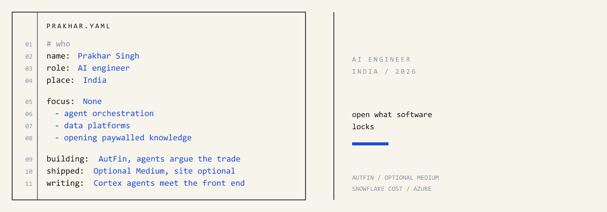

I want to be free from paywalled software and closed corporate systems. Most of what I build opens one small gate in that wall.

I build production RAG and agentic systems at Onelogica in India. I hold the SnowPro Associate and Azure AI Engineer Associate certifications.

## Open gates

01 [AutFin](https://github.com/GreatHavoc/AutFin) puts seven sub-agents on morning research duty. They pull market data, argue the trade, and carry what they learn into the next day. Built with Pydantic AI around a Zerodha portfolio.

02 [Optional Medium](https://github.com/GreatHavoc/optional-medium) opens Medium articles on a Freedium mirror, so the site itself becomes optional. Live on [Firefox Add-ons](https://addons.mozilla.org/en-US/firefox/addon/optional-medium/); Chromium installs from the GitHub release.

03 [Snowflake cost dashboard](https://github.com/GreatHavoc/snowflake-cost-dashboard) traces every query to what it cost, per request, from SNOWFLAKE.ACCOUNT_USAGE. Built to answer which request burned the budget.

04 [Azure AI agents](https://github.com/GreatHavoc/azure-agent-backend-case-study) writes down the FastAPI service that puts agents, tools, vector stores and memory behind one HTTP surface. The code stays private and the decisions are public.

05 Bank Bot moves banking workflows to WhatsApp and Telegram behind secure APIs. It passed compliance review and code audit for Azure Marketplace.

06 Fashion AI forecasting combines retrieval over social data with multimodal image and video analysis. It ranked Top 4 in the Tata Concept to Catwalk challenge.

07 AI Interview Suite tracks candidates with AI proctoring and audit records for video, audio and transcription. It runs on Azure Container Apps inside a private VNet.

## Stack

<table>
<tr><td>Agents</td><td>LangGraph, LangChain, MCP, Pydantic AI</td></tr>
<tr><td>Models</td><td>Azure OpenAI, Cortex Agents, Google models</td></tr>
<tr><td>Data</td><td>Snowflake, SQL, ELT, vector stores</td></tr>
<tr><td>Delivery</td><td>FastAPI, Azure Container Apps, Bicep, GitHub Actions</td></tr>
</table>

Walls hit and what fixed them

- Freedium's original domain stopped resolving. Optional Medium now reads the mirror from a config value and ships a working default.
- Cortex Agents had to run from the front end without exposing credentials. The calls go through Snowflake stored procedures, with prompts and agents versioned in tables.

## Milestones

- 2026-05 SnowPro Associate certified
- 2026-02 Neurone data and AI platform started
- 2025-11 Fashion AI ranked Top 4 in Tata Concept to Catwalk
- 2024-03 Azure AI Engineer Associate certified

Certifications

- SnowPro Associate, Snowflake, issued May 2026
- Databricks Certified Data Engineer Associate, issued Dec 2024, valid through Dec 2026
- Postman API Fundamentals Student Expert, issued Mar 2024
- Microsoft Certified Azure AI Engineer Associate, issued Mar 2024
- Python Foundation Certification, Infosys, issued Jul 2023
- Cybersecurity Foundation, Palo Alto Networks, issued Nov 2022
- Google Cloud Essentials, skill badge, issued Apr 2022
- Baseline Infrastructure and Networking in Google Cloud, skill badges, issued Apr 2022

## Lately

<!-- activity:start -->
**Code**
- [optional-medium: Record the 2.0.0 release channels](https://github.com/GreatHavoc/optional-medium/commit/f52ce09d80d0d28862b05a6d3739992c2c249796) - 2026-11-25
- [RealTime-Object-Detection-Model: Add README for the object-detection demo](https://github.com/GreatHavoc/RealTime-Object-Detection-Model/commit/dd7a20050bbc07dedce1cd3014d2e409b9d4a80a) - 2026-11-17
- [azure-agent-backend-case-study: Document the Azure AI agent control-plane architecture](https://github.com/GreatHavoc/azure-agent-backend-case-study/commit/1e89b8681dd421ef42cc0ee435864302284ff24d) - 2026-11-17
- [AutFin: Ignore runtime data directory](https://github.com/GreatHavoc/AutFin/commit/106ef46634ff6f86f210643bc9a93138abd8ce0a) - 2026-11-17
- [snowflake-cost-dashboard: Readme Updated](https://github.com/GreatHavoc/snowflake-cost-dashboard/commit/611bec91216f514fd48bfa9c9957dbcbec13bbe8) - 2026-04-17
- [sf-migration-toolkit: Addded checkpoints to resume from a corrupted state](https://github.com/GreatHavoc/sf-migration-toolkit/commit/daf85ba83f5f2778ea4c64de65656bd38d194a35) - 2026-04-05

**Writing**
- [I Wired Snowflake’s Cortex Agents to My Front-End. Here’s Every Wall I Hit.](https://medium.com/it-chronicles/i-wired-snowflakes-cortex-agents-to-my-front-end-here-s-every-wall-i-hit-91a615ad4f9a?source=rss-cd6d054e0c5a------2) - 2026-04-04
- [Beyond Bigger Context: Apple’s CLaRa Proposes a New Path for RAG](https://medium.com/write-a-catalyst/beyond-bigger-context-apples-clara-proposes-a-new-path-for-rag-5e917bac7923?source=rss-cd6d054e0c5a------2) - 2025-12-24
<!-- activity:end -->

[Writing](https://greathavoc.medium.com) · [LinkedIn](https://www.linkedin.com/in/prakhar-singh-244733203/) · [Coffee](https://buymeacoffee.com/greathavoc) · [Sponsors](https://github.com/sponsors/GreatHavoc)
