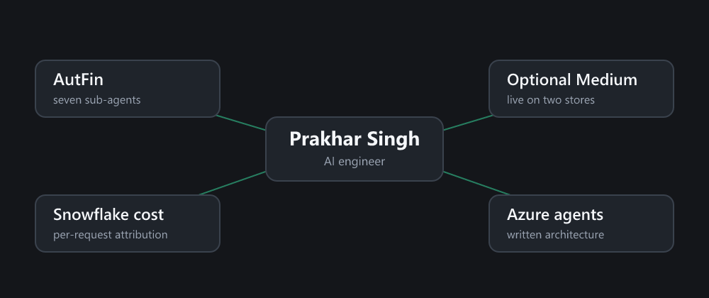
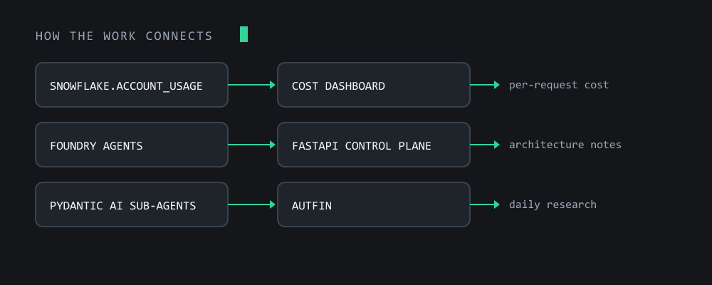

# Prakhar Singh

I want to be free from paywalled software and closed corporate systems. Most of what I build is a small step toward an ecosystem where knowledge is available to everyone.

I work on agent orchestration and data platforms at Onelogica in India.

## What I built

[AutFin](https://github.com/GreatHavoc/AutFin) runs seven coordinated sub-agents through Pydantic AI to research markets and manage a portfolio.

[Optional Medium](https://github.com/GreatHavoc/optional-medium) opens Medium articles on a Freedium mirror. Install it from [Firefox Add-ons](https://addons.mozilla.org/en-US/firefox/addon/optional-medium/) or from the GitHub release for Chromium browsers.

[Snowflake cost dashboard](https://github.com/GreatHavoc/snowflake-cost-dashboard) attributes cost to each request using data from SNOWFLAKE.ACCOUNT_USAGE.

[Azure AI agents](https://github.com/GreatHavoc/azure-agent-backend-case-study) is a written architecture of the FastAPI service that manages agents, tools and long-term memory.

## Recently

<!-- activity:start -->
**Code**
- [optional-medium: Update README with Firefox approval](https://github.com/GreatHavoc/optional-medium/commit/245ad0f1fd5b5fa6544c1b4d67eca98ddbefbaed) - 2026-11-20
- [RealTime-Object-Detection-Model: Add README for the object-detection demo](https://github.com/GreatHavoc/RealTime-Object-Detection-Model/commit/dd7a20050bbc07dedce1cd3014d2e409b9d4a80a) - 2026-11-17
- [azure-agent-backend-case-study: Document the Azure AI agent control-plane architecture](https://github.com/GreatHavoc/azure-agent-backend-case-study/commit/1e89b8681dd421ef42cc0ee435864302284ff24d) - 2026-11-17
- [AutFin: Ignore runtime data directory](https://github.com/GreatHavoc/AutFin/commit/106ef46634ff6f86f210643bc9a93138abd8ce0a) - 2026-11-17
- [snowflake-cost-dashboard: Readme Updated](https://github.com/GreatHavoc/snowflake-cost-dashboard/commit/611bec91216f514fd48bfa9c9957dbcbec13bbe8) - 2026-04-17
- [sf-migration-toolkit: Addded checkpoints to resume from a corrupted state](https://github.com/GreatHavoc/sf-migration-toolkit/commit/daf85ba83f5f2778ea4c64de65656bd38d194a35) - 2026-04-05

**Writing**
- [I Wired Snowflake’s Cortex Agents to My Front-End. Here’s Every Wall I Hit.](https://medium.com/it-chronicles/i-wired-snowflakes-cortex-agents-to-my-front-end-here-s-every-wall-i-hit-91a615ad4f9a?source=rss-cd6d054e0c5a------2) - 2026-04-04
- [Beyond Bigger Context: Apple’s CLaRa Proposes a New Path for RAG](https://medium.com/write-a-catalyst/beyond-bigger-context-apples-clara-proposes-a-new-path-for-rag-5e917bac7923?source=rss-cd6d054e0c5a------2) - 2025-12-24
<!-- activity:end -->

[Writing](https://greathavoc.medium.com) · [LinkedIn](https://www.linkedin.com/in/prakhar-singh-244733203/) · [Coffee](https://buymeacoffee.com/greathavoc) · [Sponsors](https://github.com/sponsors/GreatHavoc)
